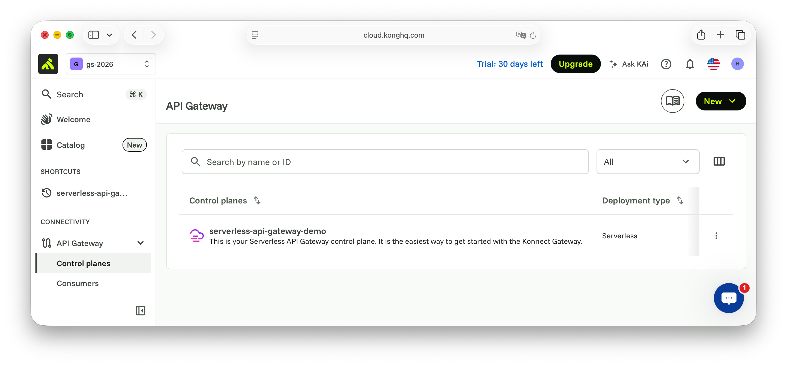
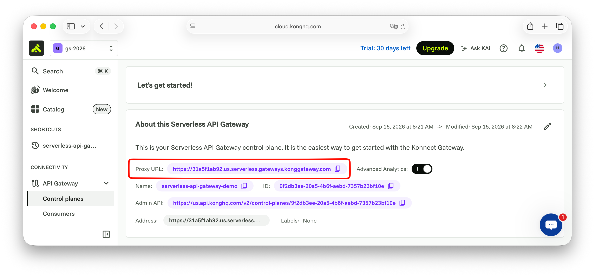
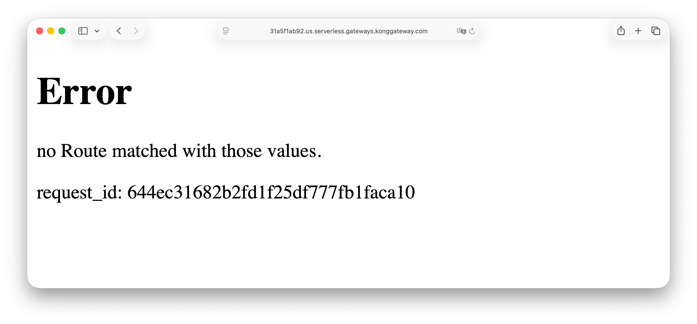

## Purpose

Prepare a Konnect **Serverless** gateway, confirm AI Gateway is available, and load the Workshop LLM environment. Later scenes call models without provider keys.

You create entities in **your** Konnect organization. Traffic goes through the **Serverless** Proxy URL on the gateway Overview. LLM credentials come from the instructor as a lab packet.

## What you will do

1. Sign up or log in at [Kong Konnect](https://cloud.konghq.com).
   - After first signup, you can use a `serverless` gateway for one month.
2. After signup, create your organization under `Create an Organization`.
   - Name example: `gs-2026`
   - `Enforce MFA enrollment` is optional.
3. Answer a few questions after the organization is created.
   - Company size
   - Konnect usage plan (e.g. workshop)
4. Confirm the region — this workshop uses **US** (Serverless on the free-tier default org path).
5. Use (or create) a Serverless gateway:
   - Left menu → **CONNECTIVITY** → **API Gateway** → **Control planes**
   - Confirm an item whose `Deployment Type` is `serverless`.



## Verify the gateway

1. Select the created `serverless` gateway.
2. Copy the `Proxy URL` from `About this Serverless API Gateway`.
3. Open the `Proxy URL` in another web browser.
4. When you see `Error` with `no Route matched with those values.`, setup is complete.





## Workshop packet

Load the Workshop LLM hub IP from the instructor into `<host>`.

```bash
# Template
export WORKSHOP_LLM_OPENAI_URL=http://<host>:8000/openai
export WORKSHOP_LLM_GEMINI_URL=http://<host>:8000/gemini
export WORKSHOP_LLM_BASE_URL=http://<host>:8000
export WORKSHOP_LLM_APIKEY=sk-kong-workshop

# Example when the instructor IP is 54.180.12.34
export WORKSHOP_LLM_OPENAI_URL=http://54.180.12.34:8000/openai
export WORKSHOP_LLM_GEMINI_URL=http://54.180.12.34:8000/gemini
export WORKSHOP_LLM_BASE_URL=http://54.180.12.34:8000
export WORKSHOP_LLM_APIKEY=sk-kong-workshop

export KONNECT_PROXY_URL=<proxy-url-from-konnect-overview>
```
